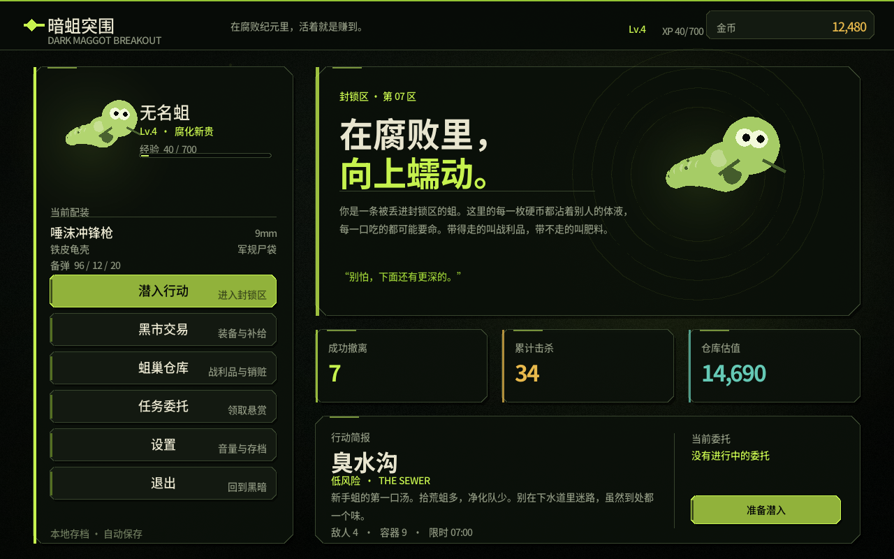
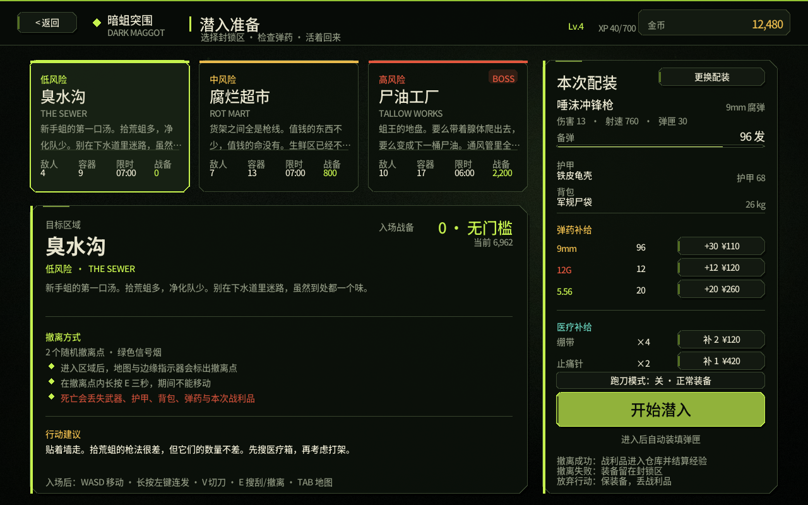
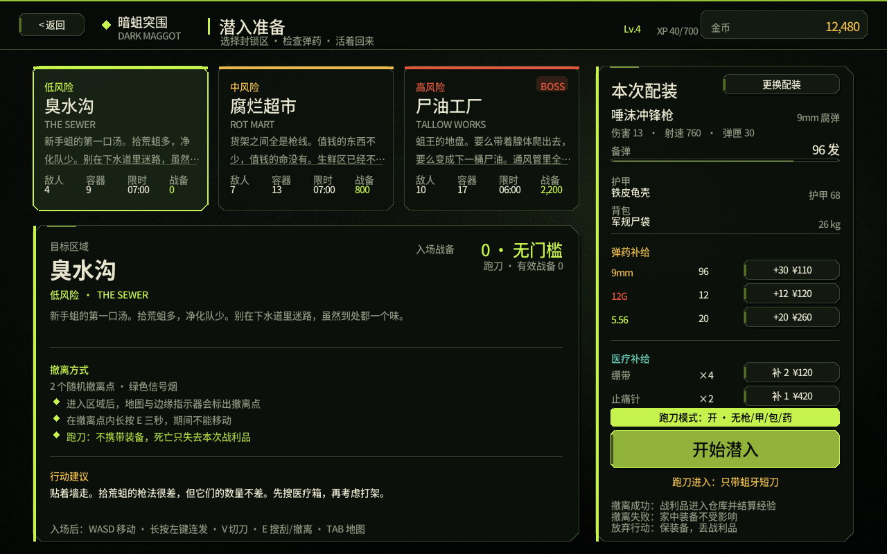
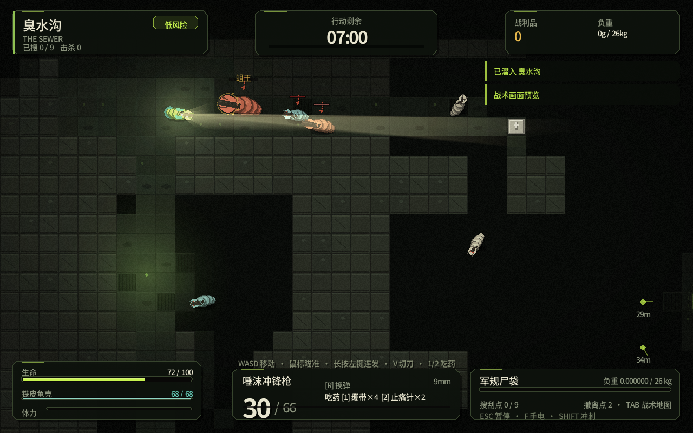
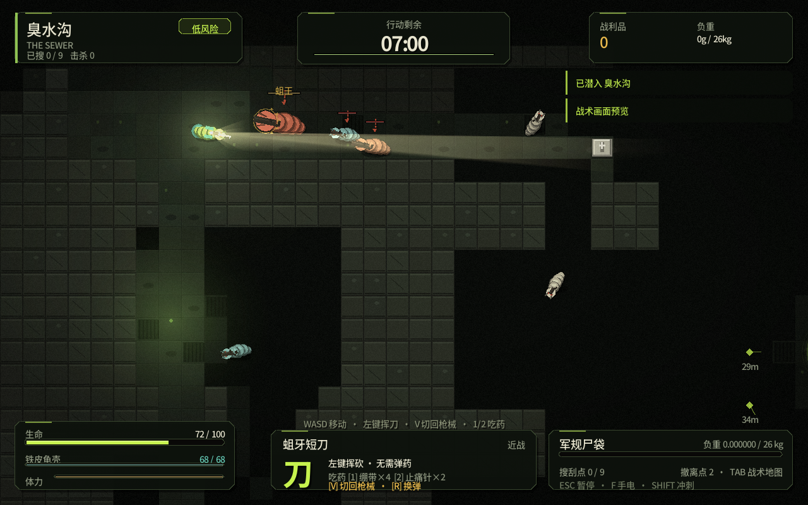
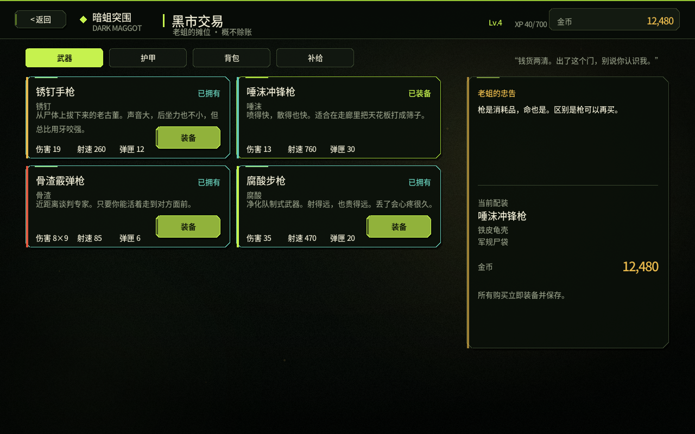
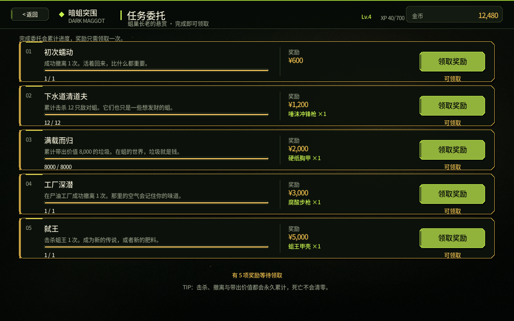

# 暗蛆突围 · DARK MAGGOT BREAKOUT

一条被丢进封锁区的蛆，靠舔包、倒卖和一点点运气，从下水道一路蠕动到蛆王的巢穴。

《暗蛆突围》是一款 **C++17 + SDL2** 编写的单机俯视角实时撤离射击游戏。玩法骨架参考《暗区突围》：带装备进入封锁区，搜刮容器和尸体，在倒计时结束前抵达撤离点；撤离成功才能把战利品带回仓库，死亡则会把装备和本次收获一起留在封锁区。角色、地图、武器、音效和 UI 全部是程序化生成或本地绘制的，没有联网依赖，也没有外部素材包。



## 快速开始

环境要求：Linux、C++17 编译器、SDL2 运行库。仓库已经带了 SDL2 头文件，因此不需要安装 `SDL2-devel`。Windows 版已用 MinGW-w64 交叉编译，解压后直接运行 `maggot.exe`。

```bash
# 编译
make -j4

# 启动
./build/maggot
```

如果运行时提示找不到 `libSDL2-2.0.so.0`：

```bash
# Fedora
sudo dnf install sdl2-compat
# 或者安装传统的 SDL2 运行库
sudo dnf install SDL2
```

游戏默认读取可执行文件旁边的 `save.dat`（本仓库中即 `build/save.dat`）。删除该文件，或在“设置 → 危险区域 → 清空存档”中重置进度。`--no-save` 可以跳过读写存档。

## 操作

| 操作 | 按键 |
| --- | --- |
| 移动 | `WASD` / 方向键 |
| 瞄准 / 连发 | 鼠标 / 长按左键（可在设置中关闭连发） |
| 近战 | 弹药耗尽自动切蛆牙短刀，左键挥砍；有备弹时按 `R` 切回枪械 |
| 手动切刀 / 收刀 | `V`（有枪有弹时也可以主动切刀） |
| 换弹 | `R` |
| 冲刺 | `Shift`（消耗体力） |
| 搜索容器 / 尸体 | 靠近后按住 `E`（约 0.95 秒，需低速） |
| 撤离 | 站在撤离点内按住 `E`（3 秒） |
| 吃药（绷带） | `1` |
| 吃药（止痛针） | `2` |
| 战术手电 | `F` |
| 战术地图 | `Tab`（暂停世界） |
| 暂停 / 返回 | `Esc` |

`WASD` 和方向键都可以移动；`E` 是按住交互，不是点按。按 `1` 吃绷带、按 `2` 打止痛针，生命值已满时不会消耗。设置中可以调整音量、静音、屏幕震动、全屏，以及“长按连发”开关。

游戏不需要输入文字，启动时会主动关闭 SDL 文本输入，避免中文/日文输入法把 `WASD`、`E`、`R` 当成拼音候选吃掉。如果字母键仍然无响应，请先把系统输入法切到英文模式再进游戏；仍无效时可以运行 `./build/maggot --keydebug`，正常按键应在终端打印类似 `KEYDOWN sc=26 sym=0x77 name=W` 的事件，便于排查。冲刺、换弹和打包都会影响移动速度。背包越满，移动越慢；超过容量 88% 会额外减速。

## 核心循环

1. **蛆巢**：查看配装、金币、等级、仓库估值和任务进度。
2. **潜入准备**：选择封锁区，确认武器、护甲、背包、弹药和医疗品。点右上角“更换配装”可打开配装终端，在已拥有的武器/护甲/背包之间切换，并实时预览伤害、射速、护甲、容量和战备值。可在右侧快速补货；打开“跑刀模式”后本次只带蛆牙短刀，不带枪、护甲、背包、弹药和药品，有效战备按 0 计算，家中装备死亡也不会丢。
3. **封锁区**：搜刮、战斗、听枪声、辨别撤离点方向，在 6–7 分钟内活着出去。
4. **行动结算**：成功撤离 → 战利品进入仓库并结算经验；死亡 → 失去随身装备和本次战利品；放弃 → 保留装备，丢掉战利品。
5. **黑市 / 仓库 / 任务**：卖垃圾、升级装备、领取任务奖励，然后再次下潜。

死亡会把手上的武器、护甲、背包、弹药和医疗品重置为初始套装（锈钉手枪 / 赤裸软体 / 破洞塑料袋 / 9mm ×18 / 绷带 ×1），并失去本次随身携带的那一套装备；已经解锁在家的同款不会重复扣费。仓库、金币和未携带的配装不会被清空。

## 封锁区

| 区域 | 风险 | 规模 | 敌人 | 容器 | 时限 | 入场战备 | 解锁条件 |
| --- | --- | --- | --- | --- | --- | --- | --- |
| 臭水沟 | 低 | 46×34 | 4 | 9 | 07:00 | **0** | 初始解锁 |
| 腐烂超市 | 中 | 60×44 | 7 | 13 | 07:00 | **800** | 累计撤离 1 次 |
| 尸油工厂 | 高 / BOSS | 72×56 | 10 | 17 | 06:00 | **2,200** | 累计撤离 3 次 |

地图由 BSP 房间 + 走廊程序化生成，每次进入的布局、容器、敌人和撤离点都会变化。地图中有 2 个随机撤离点，绿色信号烟和屏幕边缘的菱形标记会指示方向。未探索区域在战术地图上保持黑色。

## 战备值

战备值是进入封锁区的最低装备估值，类似“带多少钱的装备才准进这张图”。它由当前携带的武器、护甲、背包、备弹和医疗品折算而成：

- 武器、护甲、背包按黑市价格计算；
- 备弹按“当前发数 ÷ 每箱发数 × 每箱价格”折算；
- 绷带按 60 金币/个、止痛针按 420 金币/个计算；
- **不计入**仓库里的物品和金币。

初始套装约 **558** 点；一把唾沫冲锋枪 + 铁皮龟壳 + 军规尸袋约 **5,358** 点；满配约 **6,962** 点。臭水沟无门槛（0），腐烂超市要求 800，尸油工厂要求 2,200。战备不足时“开始潜入”会变灰，并显示还差多少。









## 战斗与搜刮

- 四种武器：锈钉手枪、唾沫冲锋枪、骨渣霰弹枪、腐酸步枪。不同伤害、射速、弹匣、扩散和枪声吸引范围。
- 枪里和背包都没有当前弹药时自动切成蛆牙短刀：左键近战挥砍，不消耗弹药；捡到同类弹药会切回枪械，也可以按 `R` 手动装弹。
- 按 `V` 可以随时手动切刀/收刀。手动切刀后不会因为捡到弹药而自动换枪，方便整局跑刀。
- 准备界面的“跑刀模式”会以空手、无甲、无背包、无药品进入，只能使用蛆牙短刀；这种模式只建议进臭水沟，死亡不会损失家中装备。
- 护甲有独立耐久，先吃伤害再按减伤比例保护生命；不同护甲等级差距明显。
- 敌人有视野、听觉、警戒、搜索、追击和近距离攻击。枪声会惊动附近敌人，手电会提高被发现概率，关闭手电则降低视野。所有敌对蛆始终显示，不受手电光锥、视野、雾区或墙体遮挡影响，不会再“凭空消失”；尸体仍会短暂停留后消失。
- 尸油工厂有蛆王：高血量、高护甲，生命低于 40% 会狂暴。
- HUD 会持续显示“吃药 [1] 绷带×N [2] 止痛针×N”；满血时不会消耗药品。
- 容器分木箱、医疗箱、弹药箱；尸体也会掉落弹药、医疗品和贵重品。
- 战利品有重量，受背包容量限制；贵重品和垃圾都可以回仓库卖给黑市。
- 爆头/暴击、伤害数字、弹道曳光、弹壳、血迹、泥浆拖痕和屏幕震动提供即时反馈。

## 仓库、黑市与任务

- **蛆巢仓库**：顶部“当前配装”会显示武器、护甲、背包和补给；下方按稀有度显示物品，可卖 1 个、整组、所有垃圾或全部。仓库重量单独计算，不影响下潜负重。
- **黑市交易**：武器、护甲、背包、弹药、医疗品。第一次购买会永久解锁该装备并立即装备；之后在配装终端或黑市里可以免费切换，不需要重复购买。死亡只失去当前携带的那一套。
- **任务委托**：5 条长期任务，覆盖撤离、击杀、带出价值、工厂撤离和击杀蛆王；奖励金币、武器、护甲，进度永久累计。
- **等级**：经验来自撤离、击杀、战利品价值和 BOSS；等级只影响展示和长期目标，不直接改数值。





## 构建细节

```text
src/
  core.*        基础类型、颜色、向量、随机数、射线检测
  font.*        MGF2 位图字体加载与绘制
  ui.*          Input / UI 绘制 / 后处理（辉光、暗角、颗粒）
  audio.*       程序化音效与循环环境音
  data.*        武器、护甲、背包、物品、地图、任务、敌人数据
  map.*         BSP 地图生成、DDA 视线、A* 寻路、战争迷雾
  profile.*     存档、仓库、装备、任务、经济
  raid.*        单局状态、玩家、敌人 AI、射击、搜刮、撤离
  raid_render.* 封锁区渲染、光照、HUD、战术地图
  game.*        SDL 生命周期、场景切换、存档、截图
  game_screens.* 蛆巢 / 准备 / 仓库 / 任务 / 黑市 / 设置 / 结算
  main.cpp      命令行入口
tools/gen_font.py  从 Noto Sans CJK 生成 MGF2 字体图集
third_party/SDL2/   vendored SDL2 头文件
assets/font.bin     生成好的中文字体图集（约 3 MB）
```

- 没有使用外部图片、音频或字体素材包；蛆、枪、地面、箱子、光照、噪点、音效全部由代码绘制/合成，唯一的运行时资源是 `assets/font.bin` 字体图集。
- 中文 UI 使用 `assets/font.bin`：8-bit alpha 图集 + 行程编码，加载时展开为 RGBA 纹理。修改 `src/` 中的中文文案后运行 `make font` 重新生成；需要 Python 3、Pillow 和系统里的 Noto Sans CJK。
- 存档格式是可读文本，原子写入 `save.dat.tmp` 后重命名。
- 无头截图：

```bash
./build/maggot --shot hub out.bmp
./build/maggot --map 2 --seed 42 --shot raid out.bmp
make shots   # 重新生成 docs/screens/*.png
```

## Windows 构建

仓库附带 `Makefile.mingw`。在 Fedora 上交叉编译需要 MinGW-w64 编译器与 SDL2 MinGW 开发包：

```bash
make -f Makefile.mingw
make -f Makefile.mingw bundle
```

默认使用本次构建的 `/home/noi/dsh/mingw64` 与 `/home/noi/dsh/sdl2-mingw`；可以用 `MINGW_BIN=`、`MINGW_SYSROOT=`、`SDL2_MINGW=` 覆盖。`bundle` 会把 `SDL2.dll`、`libwinpthread-1.dll` 和 `assets/font.bin` 复制到 `build-win/`。Windows 版运行 `maggot.exe` 时，当前目录应包含同目录的 `assets/font.bin`。

## 已知范围

这是一个完整的单机小游戏，不是《暗区突围》的 1:1 复刻：没有联机、玩家交易行、武器改装、复杂弹道穿甲和长期赛季。当前版本把“带装备进图 → 搜刮 → 战斗 → 撤离/死亡 → 仓库经济”的闭环做完整，并加入了蛆主题的武器、敌人、地图和任务。

## 许可与致谢

- 代码：本项目。
- SDL2：zlib License，见 `third_party/SDL2/LICENSE.txt`。
- 字体：Noto Sans CJK SC，SIL Open Font License；`assets/font.bin` 是由它生成的位图图集。
